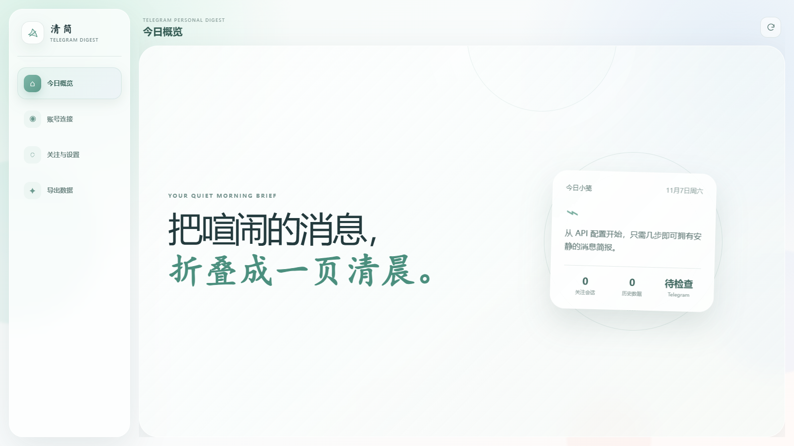

# Telegram Digest

面向个人用户的 Telegram 消息整理工具：从本人有权访问的群聊与频道中增量读取消息，按会话导出适合 AI 分析的 JSONL 文件。

> [!IMPORTANT]
> 本项目使用 Telegram 用户 API，需要用户自行申请 `api_id` 和 `api_hash`，并使用自己的手机号登录。



## 功能

| 功能 | 说明 |
| --- | --- |
| 个人账号连接 | 使用 `api_id`、`api_hash`、手机号和验证码登录；未设置两步验证时密码可留空 |
| 会话多选 | 在群聊和频道列表前勾选多个会话，一次完成配置 |
| 偏好分组 | 保存常用会话组合，下次无需逐个查找 |
| 增量读取 | 首次按时间范围读取，后续根据每个会话的消息 ID 继续处理 |
| 独立 JSONL | 每个群聊或频道单独生成文件，避免不同会话内容混在一起 |
| 批量下载 | 支持单个下载和批量下载导出的 JSONL 文件 |
| AI 总结提示词 | 内置可复制的中文提示词，用于生成详细总结与总结图片 |
| 两种启动方式 | 支持 Docker 部署，也可在 Windows 中双击脚本直接启动网页版 |

## 技术栈

- Telegram：Telethon
- Web API：FastAPI、Uvicorn
- 网页界面：HTML、CSS、JavaScript
- 数据格式：JSON、JSONL
- 部署：Docker、Docker Compose
- 测试：Python `unittest`

## 关键实现

### 增量消息整理

程序为每个会话保存最后一次成功导出的消息 ID。首次运行默认读取最近 24 小时、每个会话最多 500 条消息；后续只处理新增内容，减少重复读取和重复文件。

### 按会话输出 JSONL

不同群聊和频道不会写入同一文件。每一行都是一条完整 JSON 消息，可由 AI 或数据处理程序逐行读取：

```json
{"schema_version":1,"chat_id":-1001234567890,"chat_title":"示例群聊","chat_kind":"群组","message_id":123,"timestamp":"2026-11-07T14:30:00+08:00","sender":"示例用户","text":"示例消息"}
```

### 数据流

```text
Telegram 用户 API
  → Telethon 读取有权访问的消息
  → 按会话去重并更新增量进度
  → 每个会话生成独立 JSONL
  → 用户下载后交给所选 AI 进行总结
```

### 本地数据隔离

本地版本将配置、登录会话、增量状态和导出文件保存在运行目录；Docker 版本保存在 `telegram-digest-data` 本地数据卷。源码仓库只包含配置示例，不包含真实账号或聊天内容。

## Docker 部署

克隆项目并启动：

```powershell
git clone https://github.com/jmsgfc/telegram_digest.git
cd telegram_digest
docker compose up --build -d
```

浏览器打开：

```text
http://127.0.0.1:8765
```

停止服务：

```powershell
docker compose down
```

`docker compose down` 不会删除登录信息和导出数据。若需要彻底清理，应在确认不再需要数据后手动删除 `telegram-digest-data` 数据卷。

## Windows 直接启动

电脑安装 Python 3.10 或更高版本后，克隆或下载项目，双击 `启动网页版.cmd`。

脚本首次运行会自动创建 `.venv` 并安装依赖，随后启动本地服务并打开 `http://127.0.0.1:8765`。以后直接双击同一脚本即可；关闭名为 `Telegram Digest` 的命令行窗口即可停止服务。

Docker 与 Windows 直接启动都使用本机 `8765` 端口，请勿同时运行；切换前先停止正在使用的方式。

## 使用

1. 在 [my.telegram.org](https://my.telegram.org/) 创建应用，取得 `api_id` 和 `api_hash`。
2. 打开“账号连接”，分别填写国家或地区区号、手机号和 API 信息。
3. 获取并填写 Telegram 验证码；没有两步验证密码时留空。
4. 在“关注与设置”中勾选一个或多个会话，也可以保存为偏好分组。
5. 在“生成摘要”中读取新增消息并生成 JSONL。
6. 在“导出与回看”中下载单个文件或批量下载。
7. 点击“总结提示词”，复制提示词并与 JSONL 文件一同交给 AI。

## 项目结构

```text
src/telegram_digest/              网页后端与消息导出逻辑
src/telegram_digest/web_static/   网页界面资源
tests/                            单元测试与接口测试
data/                             本机配置、登录会话和增量状态（不提交）
output/                           JSONL 消息导出（不提交）
docs/project/                     项目图片与补充说明
Dockerfile                        Docker 镜像配置
docker-compose.yml                本地容器部署配置
启动网页版.cmd                    Windows 一键启动脚本
```

## 隐私与限制

- 程序不会下载图片、语音或其他附件，也不进行 OCR 和语音转写。
- 当前增量机制不追踪已经导出消息的后续编辑或删除。
- Telegram 可能实施登录验证和访问频率限制；遇到限流时应按提示等待，不要频繁重试。
- 导出的 JSONL 可能包含个人信息。上传给 AI 前，请确认所选服务的数据处理政策，并按需脱敏。

## 致谢

- [Telethon](https://github.com/LonamiWebs/Telethon)：Telegram MTProto 客户端库
- [FastAPI](https://github.com/fastapi/fastapi)：Web API 框架
- [Folia-Customization](https://github.com/jmsgfc/Folia-Customization)：本 README 的信息组织风格参考
